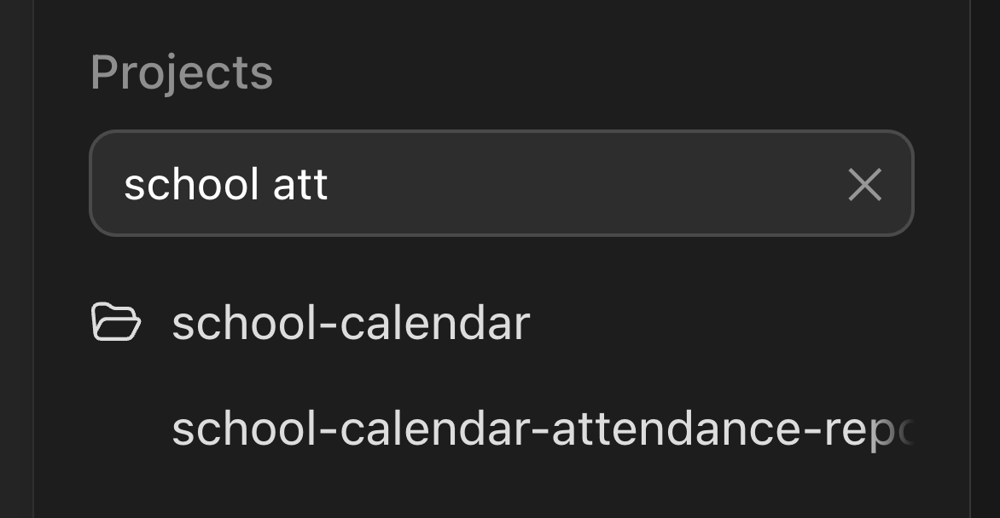

# chatgpt-project-filter

Live project filter for the ChatGPT/Codex macOS desktop app sidebar.

- Type in the box under **Projects** to filter projects by name.
- Add a space and more words to also filter chat titles inside the matching projects
  (`kalender oppi` → project containing "kalender", chats containing "oppi").
- Start with `/` to search chat titles only, across all projects (`/oppi`).
- Two buttons next to the box collapse or expand all projects (one-shot, using the app's own collapse state).
- Projects and the chats inside them are listed alphabetically (visual only; the app's own order is untouched).
- "Show more" is clicked automatically and hidden, so all chats are always listed.
- Chats created within the last minute are highlighted in yellow.
- The open chat (and its project) is highlighted in navy blue.
- `Cmd+Option+P` focuses the box, `Esc` clears it.



The app bundle is not modified. `launch.sh` starts ChatGPT with `--remote-debugging-port=9222`
and `inject.mjs` injects `project-filter.js` into the renderer over the Chrome DevTools Protocol.
Note: while running this way, any local process can control the app via port 9222.

## Use

```bash
./launch.sh
```

Optional Dock launcher:

```bash
osacompile -o "ChatGPT Filter.app" -e "do shell script \"$PWD/launch.sh >/dev/null 2>&1 &\""
```

Requires Node 22+. Relies on the sidebar's `data-*` attributes, which may change in app updates.
